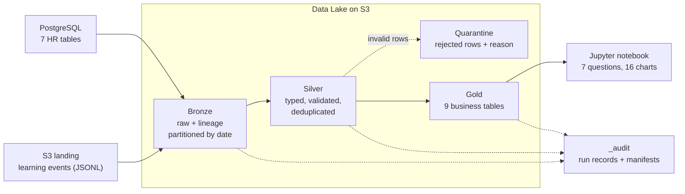

# ACME Performance & Talent ETL (`acme-perf-etl`)

A batch ETL pipeline and medallion data lake that consolidates ACME's employee performance,
competency, talent-review, project and learning data, validates it, and publishes curated
**Gold** tables that answer seven business questions about performance, skills, promotion,
training and attrition.

* **Sources:** PostgreSQL (7 HR tables) and S3 (783 daily JSONL files of learning events)
* **Lake:** Bronze (raw) → Silver (validated) → Gold (business tables), stored as Parquet on S3
* **Runs:** locally (PostgreSQL + LocalStack) or in AWS (Aurora + S3 + Lambda), switched by environment variables only
* **Quality:** schema contracts, business rules, quarantine with reasons, row-count reconciliation at every step
* **Tests:** 64 tests, 97% coverage; performance verified at 10× data volume
* **Insights:** [`data/notebooks/performance_insights.ipynb`](../../data/notebooks/performance_insights.ipynb)
  ([HTML version](../../data/notebooks/performance_insights.html))

---

## 1. Architecture



| Layer | Responsibility | Code |
|---|---|---|
| Ingestion (Bronze) | Copy sources unchanged, add lineage, partition by date, load events incrementally | `lib/bronze.py` |
| Transformation (Silver) | Parse, cast types, apply schema contracts and business rules, quarantine failures | `lib/silver.py`, `lib/contracts.py`, `lib/validation.py` |
| Serving (Gold) | Business tables with an enforced grain, one per question | `lib/gold.py` |
| Shared | Config from env vars, structured logging and step metrics, PostgreSQL/S3 I/O with retries | `lib/config.py`, `lib/logging_utils.py`, `lib/storage.py` |
| Entry point | Lambda handler and CLI; runs stages and writes the run audit | `function.py` |

**Tech stack:** Python 3.13, Pandas 3, NumPy, PyArrow (Parquet), boto3 (S3), psycopg2 (PostgreSQL),
PostgreSQL 18, LocalStack (local S3), AWS Lambda (via the workshop's Terraform), pytest + pytest-cov, Jupyter + Matplotlib.

---

## 2. Repository layout

```
backend/acme-perf-etl/          # this service (deployed as a Lambda by bin/deploy-backend.sh)
├── function.py                 # entry point: Lambda handler + CLI
├── requirements.txt            # runtime dependencies
├── pytest.ini
├── lib/
│   ├── config.py               # all settings from environment variables
│   ├── logging_utils.py        # structured JSON logs, step metrics, run audit
│   ├── storage.py              # PostgreSQL reader, S3 data lake, retry with exponential backoff
│   ├── validation.py           # reusable schema-contract engine
│   ├── contracts.py            # schema contracts for every dataset
│   ├── bronze.py  silver.py  gold.py
└── tests/                      # unit, end-to-end, resilience, integration, performance
data/
├── source/                     # sample dataset, schema.sql, load.sh
├── notebooks/                  # insights notebook, HTML export, charts/
├── evidence/                   # captured test, performance and pipeline-run output
└── requirements-dev.txt        # runtime + test + notebook dependencies
```

---

## 3. Setup and run (local)

**Prerequisites:** the workshop WorkSpace (PostgreSQL and LocalStack installed and running).

```bash
# 1. Environment (local values come from infra/locals.tf; nothing is hardcoded in code)
export IS_LOCAL=true
export POSTGRES_HOST=localhost POSTGRES_PORT=5432
export POSTGRES_NAME=postgres POSTGRES_USER=postgres POSTGRES_PASS=postgres123
export AWS_ENDPOINT_URL=http://localhost.localstack.cloud:4566
export AWS_ACCESS_KEY_ID=test AWS_SECRET_ACCESS_KEY=test AWS_REGION=ap-south-1
export DATA_LAKE_BUCKET=acme-perf-datalake-local

# 2. Python
python3 -m venv .venv && source .venv/bin/activate
pip install -r data/requirements-dev.txt

# 3. Source systems: PostgreSQL tables and the S3 landing zone
(cd data/source && bash load.sh)
aws s3 mb s3://$DATA_LAKE_BUCKET
aws s3 cp data/source/learning_activity s3://$DATA_LAKE_BUCKET/landing/learning_activity/ --recursive

# 4. Run the pipeline
cd backend/acme-perf-etl
python function.py all                       # bronze -> silver -> gold
python function.py silver                    # or a single stage
FULL_REFRESH=true python function.py bronze  # re-ingest every event partition

# 5. Tests
python -m pytest                             # 63 tests + coverage-ready (performance excluded)
python -m pytest --cov=lib --cov-report=term-missing
python -m pytest -m performance -s           # scale / throughput / SLA benchmark

# 6. Insights notebook (regenerate and execute)
cd ~/coding-workshop-participant
python data/notebooks/build_notebook.py
python -m jupyter nbconvert --to notebook --execute --inplace data/notebooks/performance_insights.ipynb
```

`load.sh` is a one-time setup step: `schema.sql` uses plain `CREATE TABLE`, so drop the tables before reloading.
The pipeline itself is fully rerunnable.

### Cloud mode

Set `IS_LOCAL=false`, unset `AWS_ENDPOINT_URL`, and use the Aurora values from the workshop Terraform outputs.
The same code then connects to Aurora **with SSL** and to real S3. The service is deployed as a Lambda by the
workshop tooling (`./bin/deploy-backend.sh local|aws`) and invoked with `?stage=all|bronze|silver|gold`,
optionally `&full_refresh=true` and `&bucket=<name>` (the bucket is passed in the request because the
workshop's `infra/` is not modified).

---

## 4. Data lake layout

| Zone | Path | Format / partitioning | Write mode |
|---|---|---|---|
| Landing | `landing/learning_activity/year=YYYY/month=MM/day=DD/*.jsonl` | Source files as delivered | External |
| Bronze tables | `bronze/<table>/year=YYYY/month=MM/day=DD/data.parquet` | One snapshot per run date | Overwrite that day only; earlier days immutable |
| Bronze events | `bronze/learning_activity/year=YYYY/month=MM/day=DD/data.parquet` | Mirrors source partitions; raw JSON lines | Incremental: existing partitions skipped |
| Silver | `silver/<dataset>/data.parquet`; events `silver/learning_activity/event_year=YYYY/` | Typed, validated | Overwrite (idempotent) |
| Quarantine | `quarantine/<dataset>/year=YYYY/month=MM/day=DD/data.parquet` | All columns as text + `_reject_reason` | Overwrite per run date |
| Gold | `gold/<table>/data.parquet` | Business tables | Overwrite (idempotent) |
| Audit | `_audit/runs/<date>/<run_id>.json`, `_audit/manifests/` | Run records and source-file manifests | Append |

Full listing: [`data/evidence/lake_layout.txt`](../../data/evidence/lake_layout.txt).

---

## 5. Lineage and source-to-target mapping

**Lineage columns** travel with every row: `_source_system`, `_source_object`, `_ingested_at`, `_run_id` (Bronze),
`_source_file`, `_line_number`, `_text_field` (events), `_silver_processed_at` (Silver), `_gold_built_at`, `_run_id` (Gold).
Every step logs rows read, written and quarantined, duration and status, and each run's audit record is stored in `_audit/runs/`.

**Bronze → Silver (what changes)**

| Dataset | Transformations |
|---|---|
| All tables | Every column cast from text to its contract type (`int`, `float`, `date`, `str`); whitespace trimmed; empty strings become null |
| learning_activity | `raw_record` JSON parsed into columns; `employee_id` text → int; `event_date` text → timestamp; **`notes` renamed to `text`** (schema drift, tracked in `_text_field`) |
| talent_review | Added `is_label_inconsistent` (Low potential but "Ready Now") |

**Silver → Gold**

| Gold table (grain) | Sources | Key transformations |
|---|---|---|
| `gold_review_history` (employee × period) | performance_reviews, employees, teams | `previous_rating`, `rating_change` (window over periods), `comment_sentiment` (keywords); `teams.name` → `team_name` |
| `gold_employee_performance` (employee) | review history | count, average, first/latest rating, `performance_trend` |
| `gold_skill_gaps` (employee × competency) | competency_assessments, competencies | `gap = required_level − proficiency_level`; `gap_severity`; `competencies.name/category` → `competency_name/category` |
| `gold_skill_distribution` (department × category × competency × level) | skill gaps | count of assessments, average gap |
| `gold_training_summary` (employee) | learning_activity | counts per event type, quiz pass rate, average quiz score, completion rate, activity in last 180 days |
| `gold_employee_profile` (employee) | all of the above + talent_review | `critical_gap_count`, `attrition_risk_score`, `derived_attrition_risk`, `promotion_status`, agreement with talent labels; `promotion_readiness` → `talent_promotion_readiness`, `attrition_risk` → `talent_attrition_risk` |
| `gold_attrition_risk`, `gold_promotion_candidates` (employee) | employee profile | Column subsets for each question |
| `gold_team_performance` (team) | employee profile, projects | headcount, average rating, % high performers / declining / high risk, project count, average outcome, % on time |

---

## 6. Data quality

**Schema contracts** (`lib/contracts.py`): types, required fields, allowed values (e.g. job levels, event types,
outcome status), ranges (ratings and levels 1–5, scores 0–100), primary-key uniqueness, schema-drift aliases.

**Business rules** (`lib/silver.py`): foreign keys (team, employee, competency exist), email and `YYYY-H1/H2` formats,
no reviews/assessments/events dated **before the employee's hire date**, no events in the future,
one review per employee per period, one assessment per employee per competency.

Invalid rows are **quarantined with a reason, never silently dropped**, and the pipeline continues.
Every Silver step reconciles `rows_read = rows_written + rows_quarantined`.

| Dataset | Read | Silver | Quarantined | Reasons |
|---|---:|---:|---:|---|
| performance_reviews | 4,000 | 3,666 | 334 | submitted before hire date |
| competency_assessments | 4,000 | 3,766 | 234 | assessed before hire date |
| learning_activity | 29,868 | 24,413 | 5,455 | 5,161 before hire · 151 duplicate event ID · 76 missing employee ID · 39 invalid date · 15 missing date · 13 malformed JSON |
| teams, competencies, employees, projects, talent_review | 4,173 | 4,173 | 0 | — (96 contradictory talent labels flagged, not removed) |

**Investigations behind these decisions**
* *Events before hire date* were a median of ~320 days and up to ~3 years early, across all event types including
  certifications. They are impossible rather than "pre-boarding", so they are quarantined.
* *Invalid dates* were free text (`"yesterday"`, `"N/A"`). Dates are not guessed, to avoid distorting timelines.
* *Schema drift*: 39 events use `notes` instead of `text`; they are mapped and tracked, not rejected.

---

## 7. Results (Gold layer)

| Question | Answer (from the notebook) |
|---|---|
| Q1 Ratings and review history | 796 improving, 767 stable, 208 declining, 124 single review, 105 with no valid review |
| Q2 Critical skill gaps | 299 employees (15%) are 2+ levels below a required level |
| Q3 Promotion | 212 ready now and high potential; talent "Ready Now" label agrees with the data for 54% of employees |
| Q4 Training | Full per-employee record of enrolments, completions, certifications and quizzes; 31 employees with no learning activity |
| Q5 Attrition risk | 173 High, 309 Medium, 1,518 Low (explainable points score); 54% exact agreement with the talent label |
| Q6 Performance vs outcomes | Weak positive correlation (r = 0.17) across the 27 teams that have projects; not conclusive |
| Q7 Skill distribution | By department, category and proficiency level (assessments: Domain 1,949 · Technical 1,222 · Leadership 595) |

---

## 8. Testing

```bash
cd backend/acme-perf-etl
python -m pytest --cov=lib --cov-report=term-missing   # 63 passed, 1 deselected, 97% coverage
python -m pytest -m performance -s                     # 1 passed
```

| Suite | What it proves |
|---|---|
| `test_validation.py` (19) | Casting, required fields, allowed values, ranges, duplicate keys, schema drift, lineage passthrough, row conservation |
| `test_transformations.py` (16) | Bronze helpers, every Silver business rule, Gold metrics against hand-computed values, grain enforcement |
| `test_pipeline_e2e.py` (12) | Real Bronze → Silver → Gold on a small known dataset: ingestion counts, partition layout, manifest file sizes, quarantine reasons, reconciliation, Gold vs Silver counts, idempotent rerun, full refresh |
| `test_resilience.py` (12) | Retry with exponential backoff for PostgreSQL and S3, no retry for bugs, fail-fast config, local/cloud switching, failed-step recording, zero-rows warning, Lambda request parsing |
| `test_integration.py` (4) | Real reads from PostgreSQL and writes/overwrites/cleanup on LocalStack S3; lake reconciliation (skipped automatically if services are unavailable) |
| `test_performance.py` (1) | Throughput, 1×/5×/10× scale, memory, SLA |

**Coverage** (target in brackets): validation 100% (90%) · contracts 100% · gold 97% (95%) · silver 96% (80%) ·
bronze 94% (80%) · storage 98% (85%) · config 100% · **total 97%**.

**Performance** (in-memory S3, so compute only):

| Scale | Employees | Source rows | Time | Throughput | Peak memory |
|---|---:|---:|---:|---:|---:|
| 1× | 2,000 | 42,174 | 1.09 s | 2.3M rows/min | 246 MB |
| 5× | 10,000 | 210,707 | 2.59 s | 4.9M rows/min | 564 MB |
| 10× | 20,000 | 421,374 | 4.52 s | 5.6M rows/min | 935 MB |

Scaling is near-linear (cost per row falls as volume grows) and the 10× run meets the 120 s SLA with a wide margin.
Against LocalStack, a cold end-to-end run takes roughly 17–20 s, dominated by reading 783 small event files;
an incremental rerun takes ~5–6 s.

**Evidence:** [`test_results.txt`](../../data/evidence/test_results.txt) ·
[`performance_results.txt`](../../data/evidence/performance_results.txt) ·
[`pipeline_run.log`](../../data/evidence/pipeline_run.log) ·
[`lake_layout.txt`](../../data/evidence/lake_layout.txt)

---

## 9. Design decisions and trade-offs

| Decision | Why | Trade-off |
|---|---|---|
| **Pandas instead of Spark** | Recommended by the guide; ~42k rows fits easily in memory; fast to test | Memory grows linearly (~1 GB at 10×); beyond that, the same layer functions would move to PySpark/Iceberg or chunked processing |
| **Backend Lambda service** instead of an EKS job in `data/` | Organizer instruction; Terraform auto-deploys `backend/<service>/function.py` | Lambda limits (15 min, memory, package size for pandas/pyarrow); the data lake bucket is passed in the request since `infra/` is not modified |
| **Bronze stores raw text** (schema-on-read) | Nothing is lost before validation, including corrupt lines | Casting happens in Silver, so Bronze is not directly analysable |
| **Incremental events, snapshot tables** | Events are append-only daily files; tables are small | Changed historical event files need `FULL_REFRESH=true` |
| **Overwrite for Silver/Gold** | Simple, guaranteed idempotency | Full recompute each run (cheap at this volume) |
| **Quarantine, don't drop** | Auditable; analysts can inspect and fix | Extra storage |
| **Flag, don't remove, contradictory talent labels** | They are valid data with questionable meaning | Consumers must check `is_label_inconsistent` |
| **Explainable rule-based scores** | Transparent to managers and testable | Less nuanced than a model; thresholds are assumptions |
| **UTC run dates** | Partitions don't depend on where the job runs | Dates differ from IST around midnight |

---

## 10. Assumptions and limitations

* **Missing data:** the business problem mentions *development plans* and *employee goals*, but the dataset contains neither.
  A `development_plans` source (employee, goal, target date, status) would be required.
* Only two review periods exist, so a "trend" is a single change. Each employee has only two competency assessments.
* Projects are linked to teams, not employees, which limits the performance-vs-outcome analysis.
* Thresholds are assumptions and easy to change in `lib/gold.py`: critical gap = 2+ levels; recent training = 180 days
  before the latest event; attrition points and promotion rules as documented in the notebook.
* Sentiment of manager comments is keyword-based.
* Developed and verified locally on LocalStack; cloud mode is configuration-only (see §3).
* Many small event files are the main I/O cost; compacting daily files into monthly ones is the first optimisation at scale.

## 11. Next steps

1. Deploy and schedule the service in AWS; add alerting on failed runs and quarantine spikes.
2. Compact small event files; add Iceberg/Delta tables for ACID and time travel if volumes grow.
3. Publish Gold to PostgreSQL or Athena for BI dashboards.
4. Add development plans, goals and employee-level project assignments as new sources.

* **Runs:** locally (PostgreSQL + LocalStack) and **deployed as an AWS Lambda** with the workshop's `deploy-backend.sh`; verified on LocalStack with all 25 steps succeeding inside the Lambda