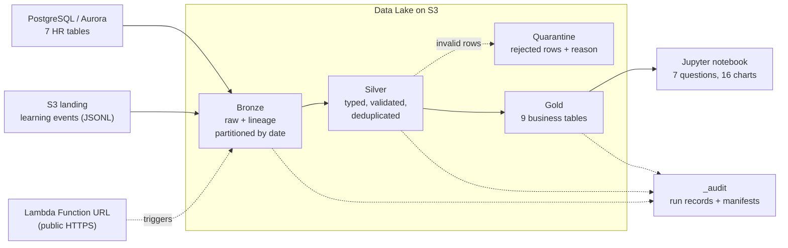

# ACME Performance & Talent ETL (`acme-perf-etl`)

A batch ETL pipeline and medallion data lake that consolidates ACME's employee performance,
competency, talent-review, project and learning data, validates it, and publishes curated
**Gold** tables that answer seven business questions about performance, skills, promotion,
training and attrition.

* **Sources:** PostgreSQL / Aurora (7 HR tables) and S3 (783 daily JSONL files of learning events)
* **Lake:** Bronze (raw) → Silver (validated) → Gold (business tables), Parquet on S3
* **Runs:** locally (PostgreSQL + LocalStack) and **deployed to real AWS** (Lambda + Aurora PostgreSQL + S3,
  region ap-south-1) with the workshop's `deploy-backend.sh`; the cloud run produces results identical to local
  and is reachable from any browser
* **Quality:** schema contracts, business rules, quarantine with reasons, row-count reconciliation at every step
* **Tests:** 71 automated tests + 1 performance benchmark; ~97% coverage; scaling verified at 10× volume
* **Insights:** [`data/notebooks/performance_insights.ipynb`](../../data/notebooks/performance_insights.ipynb)
  ([HTML version](../../data/notebooks/performance_insights.html)), 16 Matplotlib charts answering all 7 questions

---

## 1. Architecture



| Concern | Responsibility | Code |
|---|---|---|
| Ingestion (Bronze) | Copy sources unchanged, add lineage, partition by date, load events incrementally | `lib/bronze.py` |
| Transformation (Silver) | Parse, cast types, apply schema contracts and business rules, quarantine failures | `lib/silver.py`, `lib/contracts.py`, `lib/validation.py` |
| Serving (Gold) | Business tables with an enforced grain, one per question | `lib/gold.py` |
| Shared | Config from env vars, structured logging and step metrics, PostgreSQL/S3 I/O with retries | `lib/config.py`, `lib/logging_utils.py`, `lib/storage.py` |
| Source setup | Load the HR tables into Aurora from inside the VPC (cloud only) | `lib/source_loader.py` |
| Entry point | Lambda handler + CLI; runs stages and writes the run audit | `function.py` |

**Tech stack:** Python 3.13, Pandas, NumPy, fastparquet (Parquet), boto3 (S3), psycopg2 (PostgreSQL),
PostgreSQL 18 locally / Aurora PostgreSQL 17.7 in AWS, LocalStack, AWS Lambda, Terraform (workshop-provided),
pytest + pytest-cov, Jupyter + Matplotlib.

---

## 2. Repository layout

```
backend/acme-perf-etl/          # this service (deployed as a Lambda by bin/deploy-backend.sh)
├── function.py                 # entry point: Lambda handler + CLI
├── requirements.txt            # runtime dependencies (pandas, fastparquet, psycopg2)
├── pytest.ini
├── lib/
│   ├── config.py               # all settings from environment variables
│   ├── logging_utils.py        # structured JSON logs, step metrics, run audit
│   ├── storage.py              # PostgreSQL reader, S3 data lake, retry with exponential backoff
│   ├── validation.py           # reusable schema-contract engine
│   ├── contracts.py            # schema contracts for every dataset
│   ├── bronze.py  silver.py  gold.py
│   └── source_loader.py        # loads the HR source tables into Aurora (cloud setup)
└── tests/                      # unit, end-to-end, resilience, integration, cloud-mode, performance
data/
├── source/                     # sample dataset, schema.sql, load.sh, learning_activity/
├── notebooks/                  # insights notebook, HTML export, charts/, build_notebook.py
├── evidence/                   # captured test, performance, pipeline-run and AWS deployment output
└── requirements-dev.txt        # runtime + test + notebook dependencies
```

Everything outside `backend/acme-perf-etl/` and `data/` (frontend, infra, docs, bin, examples) is unchanged.

---

## 3. Run locally (PostgreSQL + LocalStack)

```bash
# 1. Environment (local values come from infra/locals.tf; nothing is hardcoded in code)
export IS_LOCAL=true
export POSTGRES_HOST=localhost POSTGRES_PORT=5432
export POSTGRES_NAME=postgres POSTGRES_USER=postgres POSTGRES_PASS=postgres123
export AWS_ENDPOINT_URL=http://localhost.localstack.cloud:4566
export AWS_ACCESS_KEY_ID=test AWS_SECRET_ACCESS_KEY=test AWS_REGION=ap-south-1
export DATA_LAKE_BUCKET=acme-perf-datalake-local     # optional locally (this is the default)

# 2. Python
python3 -m venv .venv && source .venv/bin/activate
pip install -r data/requirements-dev.txt

# 3. Source systems: PostgreSQL tables and the S3 landing zone
(cd data/source && bash load.sh)
aws s3 mb s3://$DATA_LAKE_BUCKET
aws s3 cp data/source/learning_activity s3://$DATA_LAKE_BUCKET/landing/learning_activity/ --recursive

# 4. Run the pipeline
cd backend/acme-perf-etl
python function.py all                       # bronze -> silver -> gold
python function.py silver                    # or a single stage
FULL_REFRESH=true python function.py bronze  # re-ingest every event partition

# 5. Tests
python -m pytest --cov=lib --cov-report=term-missing   # 71 tests (performance excluded)
python -m pytest -m performance -s                     # scale / throughput / SLA benchmark

# 6. Insights notebook (regenerate and execute)
cd ~/coding-workshop-participant
python data/notebooks/build_notebook.py
python -m jupyter nbconvert --to notebook --execute --inplace data/notebooks/performance_insights.ipynb
```

`load.sh` is a one-time setup step: `schema.sql` uses plain `CREATE TABLE`, so drop the tables before reloading.
The pipeline itself is fully rerunnable.

**LocalStack Lambda:** `./bin/deploy-backend.sh local` also deploys the service (in `us-east-1` on LocalStack).
LocalStack's hot-reload mounts the folder without the zip's dependencies, so they are vendored into the
git-ignored `.deps/` folder (`pip install -r requirements.txt -t .deps`), which the AWS zip excludes.

---

## 4. Cloud deployment (real AWS)

The service is deployed by the workshop tooling as a zip-based Lambda (`python3.13`, handler `function.handler`,
300 s timeout) inside the workshop VPC. Nothing in `infra/` is modified. Terraform injects `IS_LOCAL=false`,
the Aurora endpoint and credentials, and `APP_ID` / `APP_NAME`, from which the code derives the data lake
bucket `coding-workshop-datalake-<app_id>` (the only bucket name pattern the Lambda role may use).

**In AWS:** Aurora PostgreSQL (7 HR tables) and S3 landing (783 event files) → Lambda → Bronze / Silver / Gold
Parquet on S3 → public Lambda Function URL.

Run from the repo root, in a terminal **without** the LocalStack variables:

```bash
# 1. Connect to the participant AWS account (values from the workshop email)
unset AWS_ENDPOINT_URL AWS_ACCESS_KEY_ID AWS_SECRET_ACCESS_KEY AWS_SESSION_TOKEN
export EVENT_ID=<event-id> PARTICIPANT_ID=<participant-id> PARTICIPANT_CODE='<participant-code>'
./bin/setup-participant.sh

# 2. Deploy, then raise memory (the workshop module fixes 128 MB; every deploy resets it)
./bin/deploy-backend.sh aws
FN=coding-workshop-acme-perf-etl-$PARTICIPANT_ID
aws lambda update-function-configuration --function-name $FN --memory-size 512
aws lambda wait function-updated --function-name $FN

# 3. Create the data lake and upload the sources
LAKE=coding-workshop-datalake-$PARTICIPANT_ID
aws s3 mb s3://$LAKE --region ap-south-1
aws s3 cp data/source/learning_activity s3://$LAKE/landing/learning_activity/ --recursive
for f in teams competencies employees projects performance_reviews competency_assessments talent_review; do
  aws s3 cp data/source/$f.csv s3://$LAKE/landing/hr_source/$f.csv; done
aws s3 cp data/source/schema.sql s3://$LAKE/landing/hr_source/schema.sql

# 4. Load Aurora from inside the VPC (IAM-signed invoke only; refused over the public URL)
aws lambda invoke --function-name $FN --cli-binary-format raw-in-base64-out \
  --payload '{"action":"load_sources"}' --cli-read-timeout 310 load.json

# 5. Run the pipeline
aws lambda invoke --function-name $FN --cli-binary-format raw-in-base64-out \
  --payload '{"stage":"all","full_refresh":true}' --cli-read-timeout 310 run.json
curl "https://<function-url>.lambda-url.ap-south-1.on.aws/?stage=gold"   # from any device
```

Requests accept `stage=all|bronze|silver|gold` (or a list such as `silver,gold`), `full_refresh=true`, and
`bucket=<name>`, as a query string, JSON body, or direct invocation payload.

**Verified results (real AWS):**

| Check | Result |
|---|---|
| Source load into Aurora | 100 / 40 / 2,000 / 33 / 4,000 / 4,000 / 2,000 rows in 0.9 s |
| Full refresh run | HTTP 200, all **25 steps SUCCESS**; row counts identical to local (events 29,868 → 24,413 kept / 5,455 quarantined) |
| Cold run duration / peak memory | ~80 s (limit 300 s) / **210 MB** (512 MB configured) |
| Public access | Function URL called from a laptop browser outside the WorkSpace returned SUCCESS |

Evidence: [`aws_lambda_full_refresh.json`](../../data/evidence/aws_lambda_full_refresh.json) ·
[`aws_lambda_function.txt`](../../data/evidence/aws_lambda_function.txt) ·
[`aws_lambda_reports.txt`](../../data/evidence/aws_lambda_reports.txt) ·
[`aws_aurora_cluster.txt`](../../data/evidence/aws_aurora_cluster.txt)

**Problems found during deployment, and how they were solved**

| Problem | Evidence | Fix |
|---|---|---|
| Lambda package too large | 354 MB unzipped / 115 MB zipped; pyarrow alone 167 MB (limits 250 MB / 50 MB) | Switched the Parquet engine to **fastparquet** and rely on the runtime's boto3: 124 MB / 36 MB. Full test suite unchanged. |
| 128 MB memory too small | Logs: 122 MB used before any work; real peak 210 MB | Memory set to 512 MB with the AWS CLI after each deploy (no `infra/` change) |
| Aurora not reachable from the WorkSpace | Cluster is `PubliclyAccessible=False`; TCP 5432 timed out | `load_sources` action runs the same steps as `load.sh` from inside the VPC, in one transaction |
| Bucket name not allowed | Lambda role only allows `coding-workshop*<app_id>*` | Bucket derived from `APP_NAME` / `APP_ID` automatically |
| Plain "Internal Server Error" | Missing bucket crashed the audit write | Handler always returns JSON; audit-write failures are logged, not raised |
| Two overlapping runs left Bronze 38 rows short | Reconciliation showed 29,830 instead of 29,868 | Re-ran with `full_refresh`; counts matched again. Lesson: never start a run while another is active |
| CloudFront 30 s origin timeout | Full run takes ~80 s | Use the direct Function URL for full runs; CloudFront suits short calls such as `?stage=gold` |
| LocalStack: `No module named 'pandas'` | Hot-reload mounts source without dependencies | Vendored `.deps/` folder, used only inside a LocalStack Lambda |

---

## 5. Data lake layout

| Zone | Path | Format / partitioning | Write mode |
|---|---|---|---|
| Landing | `landing/learning_activity/year=YYYY/month=MM/day=DD/*.jsonl`, `landing/hr_source/` | Source files as delivered | External |
| Bronze tables | `bronze/<table>/year=YYYY/month=MM/day=DD/data.parquet` | One snapshot per run date | Overwrite that day only; earlier days immutable |
| Bronze events | `bronze/learning_activity/year=YYYY/month=MM/day=DD/data.parquet` | Mirrors source partitions; raw JSON lines | Incremental: existing partitions skipped |
| Silver | `silver/<dataset>/data.parquet`; events `silver/learning_activity/event_year=YYYY/` | Typed, validated | Overwrite (idempotent) |
| Quarantine | `quarantine/<dataset>/year=YYYY/month=MM/day=DD/data.parquet` | All columns as text + `_reject_reason` | Overwrite per run date |
| Gold | `gold/<table>/data.parquet` | Business tables | Overwrite (idempotent) |
| Audit | `_audit/runs/<date>/<run_id>.json`, `_audit/manifests/` | Run records and source-file manifests | Append |

Full listing: [`data/evidence/lake_layout.txt`](../../data/evidence/lake_layout.txt).

---

## 6. Lineage and source-to-target mapping

**Lineage columns** travel with every row: `_source_system`, `_source_object`, `_ingested_at`, `_run_id` (Bronze),
`_source_file`, `_line_number`, `_text_field` (events), `_silver_processed_at` (Silver), `_gold_built_at`, `_run_id` (Gold).
Every step logs rows read, written and quarantined, duration and status, and each run's audit record is stored in `_audit/runs/`.

**Bronze → Silver**

| Dataset | Transformations |
|---|---|
| All tables | Every column cast from text to its contract type (`int`, `float`, `date`, `str`); whitespace trimmed; empty strings become null |
| learning_activity | `raw_record` JSON parsed into columns; `employee_id` text → int; `event_date` text → timestamp; **`notes` renamed to `text`** (schema drift, tracked in `_text_field`) |
| talent_review | Added `is_label_inconsistent` (Low potential but "Ready Now") |

**Silver → Gold**

| Gold table (grain) | Sources | Key transformations |
|---|---|---|
| `gold_review_history` (employee × period) | performance_reviews, employees, teams | `previous_rating`, `rating_change` (window over periods), `comment_sentiment` (keywords); `teams.name` → `team_name` |
| `gold_employee_performance` (employee) | review history | count, average, first/latest rating, `performance_trend` |
| `gold_skill_gaps` (employee × competency) | competency_assessments, competencies | `gap = required_level − proficiency_level`; `gap_severity`; `competencies.name/category` → `competency_name/category` |
| `gold_skill_distribution` (department × category × competency × level) | skill gaps | count of assessments, average gap |
| `gold_training_summary` (employee) | learning_activity | counts per event type, quiz pass rate, average quiz score, completion rate, activity in last 180 days |
| `gold_employee_profile` (employee) | all of the above + talent_review | `critical_gap_count`, `attrition_risk_score`, `derived_attrition_risk`, `promotion_status`, agreement with talent labels; `promotion_readiness` → `talent_promotion_readiness`, `attrition_risk` → `talent_attrition_risk` |
| `gold_attrition_risk`, `gold_promotion_candidates` (employee) | employee profile | Column subsets for each question |
| `gold_team_performance` (team) | employee profile, projects | headcount, average rating, % high performers / declining / high risk, project count, average outcome, % on time |

---

## 7. Data quality

**Schema contracts** (`lib/contracts.py`): types, required fields, allowed values (job levels, event types,
outcome status), ranges (ratings and levels 1–5, scores 0–100), primary-key uniqueness, schema-drift aliases.

**Business rules** (`lib/silver.py`): foreign keys (team, employee, competency exist), email and `YYYY-H1/H2` formats,
no reviews/assessments/events dated **before the employee's hire date**, no events in the future,
one review per employee per period, one assessment per employee per competency.

Invalid rows are **quarantined with a reason, never silently dropped**, and the pipeline continues.
Every Silver step reconciles `rows_read = rows_written + rows_quarantined`.

| Dataset | Read | Silver | Quarantined | Reasons |
|---|---:|---:|---:|---|
| performance_reviews | 4,000 | 3,666 | 334 | submitted before hire date |
| competency_assessments | 4,000 | 3,766 | 234 | assessed before hire date |
| learning_activity | 29,868 | 24,413 | 5,455 | 5,161 before hire · 151 duplicate event ID · 76 missing employee ID · 39 invalid date · 15 missing date · 13 malformed JSON |
| teams, competencies, employees, projects, talent_review | 4,173 | 4,173 | 0 | none (96 contradictory talent labels flagged, not removed) |

**Investigations behind these decisions**
* *Events before hire date* were a median of ~320 days and up to ~3 years early, across all event types including
  certifications. They are impossible rather than "pre-boarding", so they are quarantined.
* *Invalid dates* were free text (`"yesterday"`, `"N/A"`). Dates are not guessed, to avoid distorting timelines.
* *Schema drift:* 39 events use `notes` instead of `text`; they are mapped and tracked, not rejected.

---

## 8. Results (Gold layer)

| Question | Answer (from the notebook) |
|---|---|
| Q1 Ratings and review history | 796 improving, 767 stable, 208 declining, 124 single review, 105 with no valid review |
| Q2 Critical skill gaps | 299 employees (15%) are 2+ levels below a required level |
| Q3 Promotion | 212 ready now and high potential; talent "Ready Now" label agrees with the data for 54% of employees |
| Q4 Training | Full per-employee record of enrolments, completions, certifications and quizzes; 31 employees with no learning activity |
| Q5 Attrition risk | 173 High, 309 Medium, 1,518 Low (explainable points score); 54% exact agreement with the talent label |
| Q6 Performance vs outcomes | Weak positive correlation (r = 0.17) across the 27 teams that have projects; not conclusive |
| Q7 Skill distribution | By department, category and proficiency level (assessments: Domain 1,949 · Technical 1,222 · Leadership 595) |


## 9. Testing

```bash
cd backend/acme-perf-etl
python -m pytest --cov=lib --cov-report=term-missing   # 71 passed, 1 deselected
python -m pytest -m performance -s                     # 1 passed
```

| Suite | What it proves |
|---|---|
| `test_validation.py` (19) | Casting, required fields, allowed values, ranges, duplicate keys, schema drift, lineage passthrough, row conservation |
| `test_transformations.py` (16) | Bronze helpers, every Silver business rule, Gold metrics against hand-computed values, grain enforcement |
| `test_pipeline_e2e.py` (12) | Real Bronze → Silver → Gold on a small known dataset: ingestion counts, partition layout, manifest file sizes, quarantine reasons, reconciliation, Gold vs Silver counts, idempotent rerun, full refresh |
| `test_resilience.py` (11) | Retry with exponential backoff for PostgreSQL and S3, no retry for bugs, local/cloud switching, failed-step recording, zero-rows warning, request parsing |
| `test_cloud_mode.py` (9) | Bucket derivation in AWS, Aurora source loading (transactional, fails before touching the database if a file is missing), `load_sources` refused over the public URL, handler always returns JSON |
| `test_integration.py` (4) | Real reads from PostgreSQL and writes/overwrites/cleanup on LocalStack S3; lake reconciliation (skipped automatically if services are unavailable) |
| `test_performance.py` (1) | Throughput, 1× / 5× / 10× scale, memory, SLA |

**Coverage targets** (from the guide): transformations 80%, validation rules 90%, error/retry paths 85%,
business metrics 95%. All are met; see [`test_results.txt`](../../data/evidence/test_results.txt) for the per-module figures.

**Performance** (in-memory S3, so compute only):

| Scale | Employees | Source rows | Time | Throughput | Peak memory |
|---|---:|---:|---:|---:|---:|
| 1× | 2,000 | 42,174 | 1.14 s | 2.2M rows/min | 187 MB |
| 5× | 10,000 | 210,707 | 3.32 s | 3.8M rows/min | 531 MB |
| 10× | 20,000 | 421,374 | 6.50 s | 3.9M rows/min | 962 MB |

Scaling is near-linear (cost per row falls as volume grows) and the 10× run (6.5 s) meets the 120 s SLA.
With real storage I/O, a cold end-to-end run takes ~17–20 s on LocalStack and ~80 s in AWS Lambda,
dominated by reading and writing 783 small event files.

**Evidence:** [`test_results.txt`](../../data/evidence/test_results.txt) ·
[`performance_results.txt`](../../data/evidence/performance_results.txt) ·
[`pipeline_run.log`](../../data/evidence/pipeline_run.log) ·
[`memory_by_stage.txt`](../../data/evidence/memory_by_stage.txt) ·
[`lake_layout.txt`](../../data/evidence/lake_layout.txt)

---

## 10. Design decisions and trade-offs

| Decision | Why | Trade-off |
|---|---|---|
| **Pandas instead of Spark** | Recommended by the guide; ~42k rows fits easily in memory; fast to test | Memory grows linearly (~1 GB at 10×); beyond that, the same layer functions would move to PySpark/Iceberg or chunked processing |
| **Backend Lambda service** instead of an EKS job in `data/` | Organizer instruction; Terraform auto-deploys `backend/<service>/function.py` | Lambda limits (300 s, memory, 250 MB package), handled as described in §4 |
| **fastparquet instead of pyarrow** | pyarrow (167 MB) pushed the package over Lambda limits; fastparquet keeps the same Parquet lake | ~40% slower at 10× (6.5 s vs 4.5 s), still far inside the SLA |
| **Bronze stores raw text** (schema-on-read) | Nothing is lost before validation, including corrupt lines | Casting happens in Silver, so Bronze is not directly analysable |
| **Incremental events, snapshot tables** | Events are append-only daily files; tables are small | Changed historical event files need `full_refresh` |
| **Overwrite for Silver / Gold** | Simple, guaranteed idempotency | Full recompute each run (cheap at this volume); concurrent runs must be avoided |
| **Quarantine, don't drop** | Auditable; analysts can inspect and fix | Extra storage |
| **Flag, don't remove, contradictory talent labels** | They are valid data with questionable meaning | Consumers must check `is_label_inconsistent` |
| **Explainable rule-based scores** | Transparent to managers and testable | Less nuanced than a model; thresholds are assumptions |
| **Load Aurora through the Lambda** | Aurora is private to the VPC; the WorkSpace cannot reach it | `load_sources` is destructive, so it is restricted to IAM-signed invocation |
| **UTC run dates** | Partitions don't depend on where the job runs | Dates differ from IST around midnight |

---

## 11. Assumptions and limitations

* **Missing data:** the business problem mentions *development plans* and *employee goals*, but the dataset contains neither.
  A `development_plans` source (employee, goal, target date, status) would be required.
* Only two review periods exist, so a "trend" is a single change. Each employee has only two competency assessments.
* Projects are linked to teams, not employees, which limits the performance-vs-outcome analysis.
* Thresholds are assumptions and easy to change in `lib/gold.py`: critical gap = 2+ levels; recent training = 180 days
  before the latest event; attrition points and promotion rules as documented in the notebook.
* Sentiment of manager comments is keyword-based.
* Lambda memory must be raised to 512 MB after every `deploy-backend.sh aws`, because the workshop module fixes it at 128 MB;
  a production setup would set it in Terraform.
* Silver and Gold overwrite their outputs, so two runs must not overlap (observed once; detected by reconciliation and
  repaired with `full_refresh`). Reserved concurrency of 1 on the function would enforce this.
* `load_sources` drops and reloads the source tables; it exists only to seed the workshop's empty Aurora and is not part of the ETL.
* Many small event files are the main I/O cost; compacting daily files into monthly ones is the first optimisation at scale.

## 12. Next steps

1. Schedule the Lambda (e.g. EventBridge daily) and alert on failed runs and quarantine spikes.
2. Set Lambda memory and reserved concurrency in Terraform; compact small event files.
3. Add Iceberg/Delta tables for ACID and time travel if volumes grow; publish Gold to Athena or PostgreSQL for BI.
4. Add development plans, goals and employee-level project assignments as new sources.